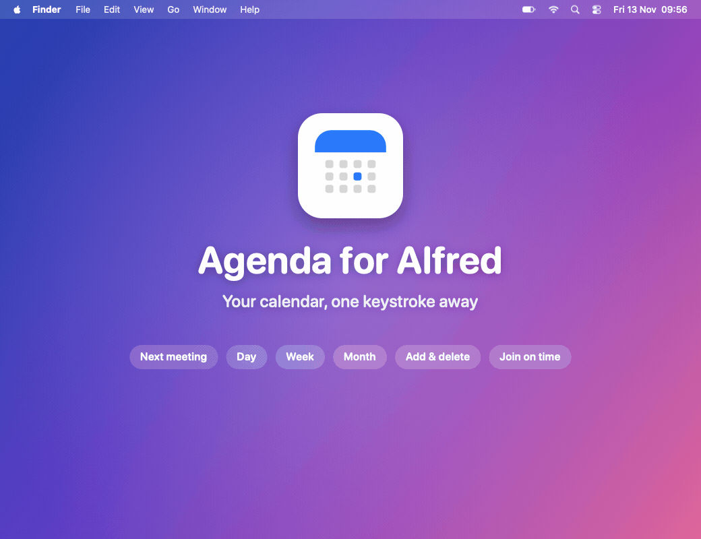

# Agenda for Alfred

Your calendar in Alfred: the next meeting and the days ahead, a day with its free time, a week and a month at a glance, and a prompt to join when a meeting starts.



*A made-up calendar; `tests/demo.sh` redraws the animation.*

## What it does

- **Next meeting first.** `cal` puts the meeting that matters now on top, with a countdown. ↩ joins it in Teams, Zoom, Google Meet, Webex and more.
- **Day, week and month.** `day` lists a day with its free gaps, ready to block; `week` and `month` are real calendar grids, all from the keyboard.
- **Add and delete in plain words.** `cal + design sync 11:30` shows the event, and what it overlaps, before you press ↩. `cal - dentist` asks before it deletes.
- **On time, every time.** A minute before a meeting with a link, Alfred opens the join list by itself. If your screen is locked, you get a notification and the list waits for you.
- **Private.** It reads the calendars already in macOS Calendar (iCloud, Exchange, Google). Nothing leaves your Mac.

## Use

`cal` · `day` (or `day fri`, `day 24/11`) · `week` (or `week +1`) · `month` (or `month dec`) · `join` · `cal + dentist tomorrow 15:00` adds an event · `cal - dentist` deletes one, after asking

The keys and settings are in the workflow's About tab and **Configure Workflow…** in Alfred.

## Install

Download **Agenda.alfredworkflow** from the [latest release](https://github.com/situmorang-com/alfred-agenda/releases/latest) and double-click it. You need macOS 14 or later and Alfred 5.5 or later with the Powerpack.

Then type `cal` and choose **Allow calendar access**: macOS asks once, for the small helper that reads your calendar (`bin/agenda-calendar`), not for Alfred as a whole.

The two helpers in `bin/` are built for Apple silicon and Intel, but they aren't notarized by Apple, and macOS flags every file that came from a download. So before each run the workflow clears that flag from its own `bin/` and `scripts/` folders ([`scripts/ready.zsh`](scripts/ready.zsh)) and touches nothing else. If you'd rather not, build it yourself.

### Build from source

You need Apple's command line developer tools (`xcode-select --install`). Clone this repository into Alfred's workflows folder and build it. To find that folder, right-click any workflow in Alfred Preferences, choose **Open in Finder**, and go up one level. Then, in Terminal:

```bash
cd "path/to/Alfred.alfredpreferences/workflows"
git clone https://github.com/situmorang-com/alfred-agenda.git user.workflow.agenda
cd user.workflow.agenda && ./build.sh
```

Agenda then appears in Alfred Preferences › Workflows (quit and reopen Alfred if it doesn't). To update, run `git pull && ./build.sh`. macOS asks for calendar access again only when the helper itself has changed.

## Remove

Run `bin/agenda alerts off`, which removes the background job that watches for meetings, then delete the workflow in Alfred.

## For developers and AI agents

Start with [AGENTS.md](AGENTS.md). Codex, Cursor and GitHub Copilot read it directly; Claude Code and Gemini CLI reach it through `CLAUDE.md` and `GEMINI.md`. The [PRD](docs/PRD.md), [architecture](docs/ARCHITECTURE.md), [shared memory](docs/MEMORY.md) and [testing guide](docs/TESTING.md) are in `docs/`.

## License

MIT, see [LICENSE](LICENSE).
