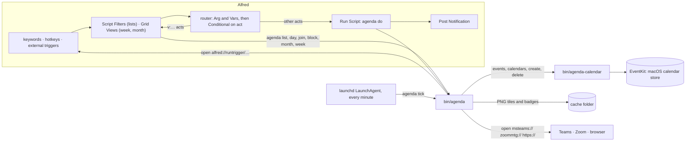
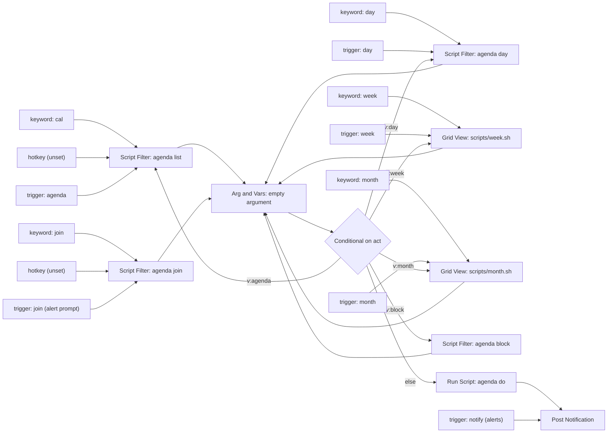

# Agenda — architecture

How the workflow is built. What it must do: [PRD.md](PRD.md). Why it is built this way, and what has been verified: [MEMORY.md](MEMORY.md). How to test it: [TESTING.md](TESTING.md).

## Overview



Each view is a short run of `bin/agenda` that prints Alfred JSON and exits. Nothing stays running apart from launchd starting `agenda tick` once a minute.

## Two binaries

**`bin/agenda-calendar` — the bridge** (`src/bridge/main.swift`). The only code that touches EventKit, and the holder of the calendar permission. macOS grants calendar access per code identity, and Alfred 5.8 declares only the pre-macOS-14 calendar key, so anything Alfred starts inherits add-only access at best. The bridge gets an identity of its own two ways:

1. Its Info.plist, with `NSCalendarsFullAccessUsageDescription`, is linked into the binary (`-sectcreate __TEXT __info_plist src/bridge/Info.plist`).
2. On launch it re-spawns itself with responsibility disclaimed (`responsibility_spawnattrs_setdisclaim`, looked up with `dlsym`; the environment marker `AGENDA_CALENDAR_CHILD` stops the loop). macOS then judges, and remembers, the grant for the bridge itself, whoever started it: Alfred, the LaunchAgent or a terminal.

It is ad-hoc signed with identifier `com.situmorang.agenda.calendar`. An ad-hoc identity is the binary's hash, so a rebuilt bridge is a new app to macOS and the user is asked again. So the bridge stays small and stable, and `build.sh` rebuilds it only when `src/bridge/` changes (hash in `bin/.bridge-source-hash`).

**`bin/agenda`** (`src/agenda/*.swift`): everything else. Rebuilt freely; it runs the bridge as a child process.

## Folder

```
info.plist          Alfred's workflow definition: objects, connections, settings, About text
prefs.plist         the user's setting values (Alfred writes it once a setting is changed)
build.sh            rebuild what changed, redraw icons, reload the workflow
package.sh          the release package: both programs for Apple silicon and Intel, zipped into dist/Agenda.alfredworkflow
bin/                agenda, agenda-calendar, .bridge-source-hash (built; don't edit)
scripts/            month.sh, week.sh: the Grid Views' script sources (exec bin/agenda); ready.zsh, sourced before every run of bin/agenda
src/agenda/         bin/agenda source
src/bridge/         bin/agenda-calendar source and the Info.plist linked into it
icons/, icon.png    drawn from SF Symbols by `bin/agenda icons` (build.sh runs it)
tests/              fixture, smoke test, previews and the README animation, live-test helper
docs/               this file, PRD, shared memory, testing guide, changelog; images/ from tests/preview.sh and tests/demo.sh;
                    LOCAL.md on the owner's Mac only
dist/               packages from package.sh (git ignores it, like bin/, prefs.plist and docs/LOCAL.md)
```

`src/agenda/`, one Swift module:

| File | Holds |
|---|---|
| `main.swift` | Command dispatch: `list`, `day`, `join`, `block`, `month`, `week`, `do`, `tick`, `alerts`, `icons`, `detect`. |
| `Core.swift` | `Env` (paths, pinned now, theme), `Config` (settings), calendar and formatting helpers (`Fmt`), the event model `Ev`, the bridge client `Bridge` (filters cancelled, declined and hidden events), `eventsByDay`. |
| `Views.swift` | List views: agenda (`viewList`), `viewDay`, `viewJoin`, `viewBlock`; the row builder `eventItem`; setup rows; the writable calendars and which comes first (`preferredCalendar`). |
| `Delete.swift` | `cal -`: `viewDeleteSearch` lists matching events, `viewConfirmDelete` the confirmation (*Keep it* first); `deleteBlocker` says why an event isn't offered. |
| `NewEvent.swift` | `cal +`: `parseDraft` reads what and when out of the text (its comments hold the rules), `viewNewEvent` shows one row per writable calendar. `viewList` hands over when the query starts with `+`. |
| `Grid.swift` | `viewMonth`, `viewWeek`. |
| `Render.swift` | PNG drawing: row badges, month and week tiles, fixed icons; the image cache. |
| `Meeting.swift` | `MeetingDetector`: finding a meeting link and turning it into the link to open. |
| `Actions.swift` | `runAction` (`agenda do`): carries out the `act` chosen in Alfred. |
| `Alerts.swift` | The LaunchAgent: install, sync, remove, the per-minute `tick`, `alerts` subcommands. |

## Alfred object graph



- Every view connects to the router with ↩, ⌘↩, ⌥↩ and ⌃↩ (the block list with ↩ only). Which action a key means is decided by the item's `variables` and `mods` in the JSON, not by the connection.
- The Arg and Vars empties the argument, so the next view opens with an empty input field; its state arrives in variables.
- Keywords are `{var:kw_*}` from the settings. External triggers (`agenda`, `day`, `week`, `month`, `join`, `notify`) are reachable as `alfred://runtrigger/com.situmorang.agenda/<id>/`.
- Script Filters run `. scripts/ready.zsh; ./bin/agenda <view> "$1"` in zsh with the query as argv, *Alfred filters results* off, and *terminate previous script* queueing. Grid Views run `scripts/<view>.sh` with the argument as `$1`: 7 columns, square tiles for the month, portrait for the week, title and subtitle in the footer, typing filters.
- Object UIDs follow `A6E0DA00-0000-4000-8000-0000000000NN`. Keep them when editing `info.plist` by hand.

## The `act` contract

Rows and tiles carry their next step in `variables`; the Conditional routes on `act`.

| `act` | Set by | Other variables | Result |
|---|---|---|---|
| `v:day` | ⌃↩ on rows, ↩ on tiles and all-day groups, day navigation | `date` (yyyy-MM-dd) | Day view of `date` |
| `v:week` | agenda footer row, ⌥↩ and ⌃↩ in the week grid | `week` (any yyyy-MM-dd in that week) | Week grid |
| `v:month` | agenda footer row, ⌥↩ and ⌃↩ in the month grid | `month` (yyyy-MM) | Month grid |
| `v:block` | ↩ on a free gap, *Block time…* | `slot` (`yyyy-MM-ddTHH:mm~yyyy-MM-ddTHH:mm`, or `yyyy-MM-dd`) | Block options |
| `v:agenda` | ↩ on a `cal -` row; *Keep it* | `confirm` (event id), `cstart` (its start); *Keep it* empties both | Agenda; with `confirm` set, the delete confirmation instead |
| `open` | ↩ or ⌘↩ on a linked event, ↩ in the join list | `url` (app link), `web` (https link) | Opens `url`; `web` if that fails |
| `cal` | ↩ or ⌘↩ on an event | `eid` (EventKit event identifier) | Opens `ical://ekevent/<eid>` in Calendar |
| `calday` | ↩ on the day header, ⌘↩ on tiles | `date` | Calendar on that day (AppleScript; Alfred asks to control Calendar the first time) |
| `copy` | ⌥↩ | `text`, `note` | Clipboard, then a notification |
| `block` | ↩ on a block option | `title`, `calid`, `start`, `end` (epoch seconds) | Bridge `create`, then a notification |
| `create` | ↩ on a new-event row (`cal +`) | `title`, `calid`, `callabel`, `start`, `end`, `allday` (`1` or `0`) | Bridge `create`, then a notification naming `callabel` |
| `delete` | ↩ on a *Delete* row of the confirmation | `eid`, `start`, `span` (`this` or `future`), `title`, `callabel` | Bridge `delete`, then a notification |
| `auth` | *Allow calendar access* row | — | Bridge `auth` (the macOS prompt) |
| `settings` | *Calendar access is switched off* row | — | Opens Privacy & Security › Calendars |

Whatever `agenda do` prints becomes the notification text; the notification only shows when there is text.

## The bridge contract

`bin/agenda-calendar <command>` prints one JSON object.

| Command | Reply |
|---|---|
| `status`, `version` | `{status, version}` / `{version}`. Never prompts. |
| `auth` | Shows the macOS prompt if access was never decided, then `{status, version}`. The only command that can prompt. |
| `calendars` | `{status, calendars: [{id, title, color, source, sourceType, writable, subscribed}], defaultCalendarId}` |
| `events <fromEpoch> <toEpoch>` | `{status, events: [Event]}`: every event overlapping the range, repeating events expanded, sorted by start. |
| `event <id>` | Same shape, at most one event. |
| `create` | Reads `{title, start, end, allDay?, notes?, location?, url?, availability?, alarmMinutes?, calendarId? or calendar?}` on stdin; saves it; `{status, ok, id, calendar}`. |
| `delete` | Reads `{id, start, span?}` on stdin: `start` picks the occurrence (no exact match, nothing deleted), `span` `future` also removes later repeats. Refuses read-only calendars and events with anyone else on them. `{status, ok, calendar}`. Since bridge version 2. |

`status` is `notDetermined`, `restricted`, `denied`, `fullAccess` or `writeOnly`; without `fullAccess` the data commands return only `{status}`. Errors are `{error, status}` with exit code 1 (2 for an unknown command).

An Event has `id` (EventKit's event identifier), `itemId`, `title`, `start`, `end` (epoch seconds), `allDay`, `recurring`, `detached`, `birthday`, `calendarId`, `calendar`, `color` (#RRGGBB), `source` (account name), `sourceType` (local, exchange, caldav, icloud, subscribed, birthdays, other), and when present `location`, `place`, `url`, `notes`, `tz`, `created`, `modified`, `occurrence`, `externalId`, `status` (confirmed, tentative, canceled, none), `availability`, `organizer {name, me}`, `attendees [{name, email, status, me, role, type}]` and `myStatus` (the user's reply). `bin/agenda` keys an occurrence as `id@start`.

## Rendering

- Sizes: row badges 128 px (weekday strip in the calendar's colour over the day number), month tiles 240 × 240, week tiles 300 × 450, fixed icons 128 px, workflow icon 512 px.
- Tiles are transparent apart from today's frame: Alfred draws each cell's background and the selection highlight.
- Cache: `<cache>/tiles` and `<cache>/badges`. A file's name is an FNV-1a hash of `Render.style`, the theme and everything drawn on it, so an unchanged tile is reused and a changed one gets a new file. Today's week tile changes every 5 minutes (the now-line). Files unused for 3 days are deleted, at most once a day. Bump `Render.style` when the look changes.
- Theme: dark unless `alfred_theme_background` is light (luminance 0.55 or more); `AGENDA_THEME` overrides.
- The week's hour range and the side-by-side columns for overlapping events are worked out per week, so blocks line up across the seven tiles.

## Meeting links

- Order: the event's URL, then location, then notes; the first recognised link wins.
- Clean-up: `&amp;` becomes `&`, trailing punctuation goes; Outlook Safe Links (`url=`), Google redirects (`/url?q=`) and URLDefense v3 wrappers are unwrapped.
- Services: Teams, Zoom (including `zoommtg://` and ZoomGov), Google Meet, Webex, Slack huddles, FaceTime, Jitsi, Whereby, Skype, GoTo, Chime, RingCentral, Lark/Feishu, Tencent/VooV, Zoho, Gather, Cal.com, Livestorm, Around.
- App links: Teams `https://` becomes `msteams://`; a Zoom `/j/<id>?pwd=…` link becomes `zoommtg://<host>/join?confno=<id>&pwd=…`. Zoom personal rooms (`/my/`) and webinars stay `https://`. The `teams_app` and `zoom_app` settings turn app links off.
- `bin/agenda detect "<text>"` shows what is found in a piece of text.

## Alerts

- **Job:** `~/Library/LaunchAgents/com.situmorang.agenda.alerts.plist`, label `com.situmorang.agenda.alerts`, runs `<workflow>/bin/agenda tick` at second 0 of every minute (60 `StartCalendarInterval` entries), process type Standard, stderr to `<data>/alerts.log`. It was Background until 15 Nov, and launchd then ran it in fewer than half of the awake minutes ([MEMORY.md › The alert job](MEMORY.md#verified-the-alert-job)).
- **Sync:** `Alerts.sync()` writes and bootstraps the plist when the setting is on and the file differs, bootstraps it again if launchd lost it, and boots it out and deletes it when the setting is *off*. The agenda and join views call it through `syncIfNeeded()` inside Alfred: at most every 10 minutes, or at once when the style or the binary's path changes (stamp: `<data>/.alerts-synced`). `bin/agenda alerts sync` runs it by hand.
- **Tick:** reads settings from `info.plist` and `prefs.plist` (there is no Alfred environment), fetches events from 10 minutes ago to the lead time plus 2 minutes ahead, and picks the due ones: timed, not yet alerted, now inside [start − lead, start + 5 min), with a link when links-only is on. It records them in `<data>/alerted.json` (`<event id>@<start, epoch seconds>` → time alerted; entries older than 2 days dropped; Google event ids contain `@` too, so split on the last one), then fires:
  - *prompt*: `open alfred://runtrigger/com.situmorang.agenda/join/`
  - *notify*: `open -g alfred://runtrigger/com.situmorang.agenda/notify/?argument=<text>`
  - *auto*: opens the first meeting's link, then notifies
  - **Screen locked or display asleep** (*prompt* and *auto* only): Alfred's window or the meeting would open unseen behind the lock screen, as on 15 Nov. So the tick posts one notification, records `held:<occurrence key>` instead, and leaves the occurrence due: the first check after the unlock, still inside the window, fires the style normally. `screenState()` reads `CGSSessionScreenIsLocked` from `CGSessionCopyCurrentDictionary()`, then `CGDisplayIsAsleep`; "unknown" counts as on.
  It writes the calendar status and event count to `<data>/.last-tick`, and appends one line per check to `<data>/ticks.log`: when it ran, seconds after the minute, the calendar status, event and alert counts, how long the calendar took, and the screen (`on`, `locked`, `asleep`, `unknown`); counts only, about two days kept. Fixture runs and `AGENDA_DRY_RUN` print `would alert (<style>): …` or `would notify (screen locked; <style> held): …` instead.
- **Commands:** `bin/agenda alerts` (status: the last check, and how many checks ran in the last hour), `alerts sync`, `alerts off`, `alerts test`.
- **Removal:** `bin/agenda alerts off` before the workflow is deleted or moved; otherwise launchd keeps starting a missing program every minute.

## Settings

`info.plist` (`userconfigurationconfig`) defines them and is the source of truth for names and defaults. Inside Alfred, values arrive as environment variables; outside Alfred (the tick, a terminal), `Config` reads the defaults from `info.plist` and the user's values from `prefs.plist`. An environment variable always wins, so tests can override any setting.

| Variable | Default | Values | Used by |
|---|---|---|---|
| `kw_agenda`, `kw_day`, `kw_week`, `kw_month`, `kw_join` | cal, day, week, month, join | text | keywords |
| `lookahead_days` | 14 | 1–60 (code accepts 1–90) | agenda |
| `week_start` | system | system, 2 (Monday), 1 (Sunday) | grids |
| `work_start`, `work_end` | 8, 18 | 0–12, 12–24 | free gaps, block presets, week hours |
| `ignored_calendars` | — | one per line: "Name" or "Name (Account)" | every view |
| `show_declined` | off | | every view |
| `alert_style` | prompt | prompt, notify, auto, off | alerts |
| `alert_lead` | 1 | 0–10 minutes (code accepts 0–30) | alerts |
| `alert_links_only` | on | | alerts |
| `teams_app`, `zoom_app` | on, on | | meeting links |
| `block_title` | Focus time | text | block time |
| `block_calendar` | — (system default) | "Name" or "Name (Account)" | new events (first row), block time |

## Files at run time

- `<cache>` = `~/Library/Caches/com.runningwithcrayons.Alfred/Workflow Data/com.situmorang.agenda`: `tiles/`, `badges/`, `.pruned`.
- `<data>` = `~/Library/Application Support/Alfred/Workflow Data/com.situmorang.agenda`: `alerted.json`, `ticks.log`, `.last-tick`, `.alerts-synced`, `alerts.log`; `.dry-run` and `dry-run.log` only during live tests.
- The LaunchAgent plist above.

## Release

`./package.sh` builds `dist/Agenda.alfredworkflow` from the last commit, without `docs/images`: both programs compiled with `-target <arch>-apple-macos14` for arm64 and x86_64, joined with `lipo`, and ad-hoc signed, the helper with its identifier and linked-in Info.plist as in `build.sh`. A downloaded package arrives flagged: Alfred keeps `com.apple.quarantine` on the files it imports, and macOS won't run flagged helpers that Apple hasn't notarized. So every entry point sources `scripts/ready.zsh` first, which clears the flag from `bin/` and `scripts/` with zsh's own `zsh/attr` (no extra process). The steps of a release are in `AGENTS.md`; the notes in `docs/CHANGELOG.md`.

## Extending

- **A list view:** a `case` in `main.swift`, a function that builds items (reuse `eventItem`) and ends with `Alfred.emit`; in Alfred, a Script Filter running `./bin/agenda <name> "$1"` connected with ↩, ⌘, ⌥ and ⌃ to the Arg and Vars. To reach it from a row, set `act` to `v:<name>` and add that branch to the Conditional.
- **A setting:** add it in Alfred's *Configure Workflow* editor (which writes `info.plist`), read it with `Config.string`, `int` or `bool`, and add it to the table above and to the PRD.
- **A meeting service:** one `(name, regex)` entry in `MeetingDetector.services`, an app link in `native(_:_:)` if the app has a URL scheme, and a smoke check.
- **The tile look:** edit `Render.swift`, bump `Render.style`, run `tests/preview.sh`.

## When something is wrong

| Symptom | Look at |
|---|---|
| "The calendar helper isn't responding" | `bin/agenda-calendar status`; run `./build.sh` |
| Empty views, or *Allow calendar access* | `bin/agenda-calendar status` should say `fullAccess`; System Settings › Privacy & Security › Calendars |
| No alerts | `bin/agenda alerts`; `<data>/ticks.log` (a line a minute while the Mac is awake; `due=1` is an alert); `tests/tools/alert-coverage.py [from] [to]` (lines the checks up with `pmset -g log`, so a missing check while awake stands out); `<data>/alerted.json` (when each occurrence was alerted); `<data>/alerts.log`; `launchctl print gui/$(id -u)/com.situmorang.agenda.alerts`. An alert that ran while the display slept went to a locked screen: here the lock is immediate. |
| ↩ does nothing | a leftover `<data>/.dry-run` |
| Tiles look out of date | bump `Render.style`, or delete `<cache>/tiles` |
| A meeting link isn't found | `bin/agenda detect "<the event's notes>"`, keeping the output on this Mac |
